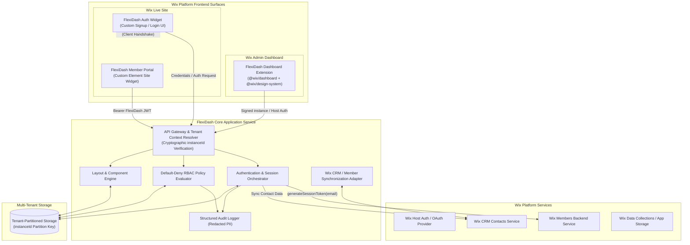
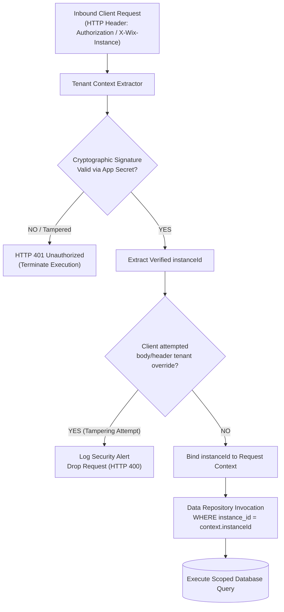
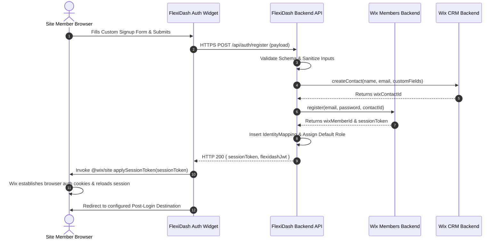
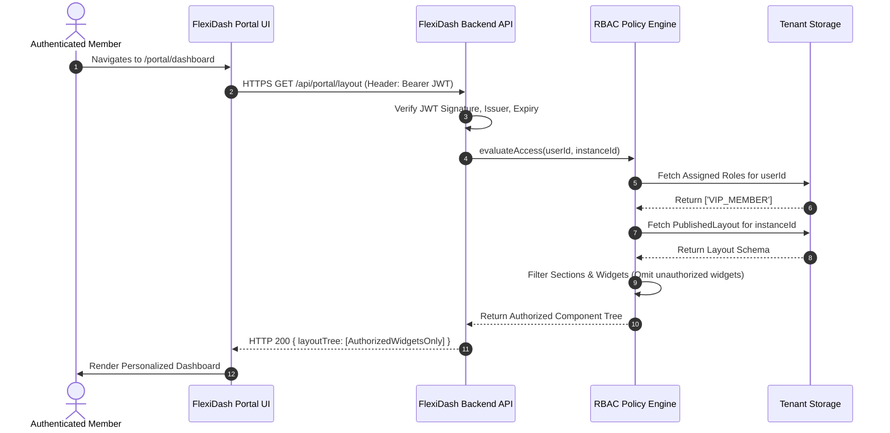
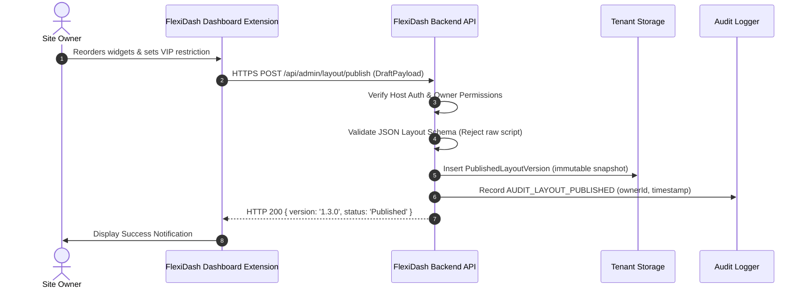

# FlexiDash System Architecture Specification

**Document Version:** 1.0.0-phase0  
**Status:** Approved Phase 0 Baseline  
**Scope:** Multi-Tenant Architecture, Component Design, Identity Taxonomy & Isolation Model  
**Related Documents:** [PRODUCT-SPEC.md](./PRODUCT-SPEC.md), [FEASIBILITY-MATRIX.md](./FEASIBILITY-MATRIX.md), [DECISIONS.md](./DECISIONS.md), [SECURITY-THREATS.md](./SECURITY-THREATS.md)

---

## 1. High-Level System Topology

FlexiDash is structured as a decoupled, multi-tenant application designed to operate within the Wix ecosystem. The system coordinates three distinct environments:
1. **The Wix Admin Environment:** Where the site owner configures forms, roles, permissions, navigation, and dashboard layouts.
2. **The Wix Live-Site Environment:** Where site visitors and authenticated members interact with custom signup/login widgets and role-specific portal dashboards.
3. **The FlexiDash Core Backend Service:** Where cryptographic tenant verification, RBAC policy evaluation, layout composition, and Wix platform synchronization occur.



---

## 2. Managed Wix CLI Extension vs. Self-Managed OAuth App Evaluation

A critical architectural determination in Phase 0 is evaluating whether FlexiDash should be implemented as a **Wix CLI-Managed Extension Application** or a **Self-Managed OAuth Application**.

### Comparative Evaluation Matrix

| Architectural Dimension | Managed Wix CLI Extension (`@wix/astro` / `@wix/cli`) | Self-Managed OAuth Application (External Next.js/Node) | FlexiDash Fit Analysis & Impact |
| :--- | :--- | :--- | :--- |
| **Dashboard UI Delivery** | Native `DASHBOARD_PAGE` extension rendered directly in Wix Admin using `@wix/design-system`. Zero iframe overhead. | Rendered inside an iframe pointing to an external URL. Requires postMessage bridge and iframe resizing logic. | **Managed CLI is superior.** Provides native look-and-feel, seamless Wix Design System styling, and instant loading without iframe sandboxing issues. |
| **Live-Site UI Delivery** | Standard `CUSTOM_ELEMENT` site widgets and Site Page Extensions packaged in the app bundle. | External web components or iframes loaded via script tag injection or custom elements. | **Managed CLI is superior.** Native packaging allows clean installation into the site editor and natural slot integration. |
| **Backend Execution** | Serverless functions hosted on Wix Cloud (Cloudflare Workers runtime via `@wix/astro`). | Full Node.js / Docker container hosted on external cloud (Vercel, AWS, GCP). | **Self-Managed has greater execution flexibility.** Wix Cloudflare runtime has strict bundle size, memory, and native Node module constraints. |
| **Hosting & Ops Overhead** | Zero external infrastructure. Wix manages hosting, SSL, deployment, and edge distribution. | High operational overhead. Developer must manage external servers, databases, monitoring, scaling, and uptime. | **Managed CLI is superior for low operational burden.** |
| **Authentication & Tokens** | Native "Host Auth" handles identity in Dashboard automatically; extension receives verified context. | Full OAuth 2.0 authorization code grant flow; must manage, rotate, and securely store refresh tokens per tenant. | **Managed CLI eliminates OAuth storage liability in dashboard contexts.** |
| **Member Session Handshake (Unverified)** | Unverified whether Astro serverless can call `generateSessionToken` and Custom Element can call `applySessionToken`. | Can implement full Headless Wix OAuth redirect with PKCE, though requires external session mapping. | **Major architectural risk:** If Wix CLI Custom Element cannot apply native session tokens, self-managed or Velo-bridged auth is required. |
| **Multi-Tenant Isolation** | Wix supplies verified `instanceId` via context runtime. | App must parse and cryptographically verify signed `instance` parameter or OAuth token on every request. | **Both support robust isolation;** Self-Managed requires dedicated cryptographic middleware. |
| **Database Flexibility** | Constrained to Wix Data Collections or external HTTP-accessible database. | Unrestricted access to any enterprise database (PostgreSQL, DynamoDB, MongoDB) with connection pooling. | **Self-Managed has superior persistence freedom for complex relational schemas.** |

### Architectural Recommendation
**Adopt a Hybrid Architecture (Accepted for PoC Only):**
1. **Frontend & Extension Surface:** Utilize the **Wix CLI Managed Application model** (the current project structure in `flexidash/` built with `@wix/astro`, `@wix/dashboard`, and `@wix/design-system`) for initial Phase 1 prototyping. This provides first-class Dashboard Page extensions and Custom Element site widgets without iframe latency.
2. **Backend Domain Logic:** Encapsulate all RBAC evaluation, schema validation, and persistence behind **decoupled service adapter interfaces**. The core logic can initially run within Wix CLI HTTP endpoints/Astro API routes, while remaining completely portable to an external self-managed backend if relational database scaling demands it in later phases.
3. **PoC Gate Requirement:** If Phase 1 spikes demonstrate that a Wix CLI Custom Element cannot establish a native Wix member session via `applySessionToken()`, the project must re-evaluate pivoting to a Self-Managed OAuth App or a companion Velo site script.

---

## 3. Identity Entity Taxonomy & Relationship Model

To prevent catastrophic security bugs and authentication bypasses, FlexiDash strictly defines and decouples five distinct identifiers:

```
┌─────────────────────────────────────────────────────────────────────────────────┐
│                                IDENTITY TAXONOMY                                │
├────────────────────────┬────────────────────────┬───────────────────────────────┤
│ Identifier             │ Subsystem Domain       │ Format / Scope                │
├────────────────────────┼────────────────────────┼───────────────────────────────┤
│ 1. wixMemberId         │ Wix Members System     │ UUIDv4, unique per Wix Member  │
│ 2. wixContactId        │ Wix CRM Contacts       │ UUIDv4, unique per Contact    │
│ 3. flexidashUserId     │ FlexiDash Core Domain  │ UUIDv4, unique per Tenant-User│
│ 4. externalSubjectId   │ External OIDC/OAuth    │ String, unique per IdP Issuer │
│ 5. instanceId          │ Wix App Platform       │ UUIDv4, unique per Site Install│
└────────────────────────┴────────────────────────┴───────────────────────────────┘
```

### Entity Distinction Guarantees
1. **`wixContactId` $\ne$ `wixMemberId`:**
   - Every registered Wix Member has an associated CRM Contact record, but their UUID values are entirely distinct.
   - An individual who is purely a CRM Contact (e.g., newsletter subscriber or guest shopper) has **no credentials, no `wixMemberId`, and cannot log in**.
   - Attempting to pass a `wixContactId` to a Members API or using it as proof of authentication is a critical security vulnerability.
2. **`flexidashUserId` Maps Explicitly to Platform IDs:**
   - FlexiDash maintains an explicit `IdentityMapping` table partitioned by `instanceId`.
   - A single `flexidashUserId` contains foreign key references: `{ flexidashUserId, instanceId, wixMemberId, wixContactId, externalSubjectId, email }`.
3. **Token Independence:**
   - **`wixSessionToken`:** Issued exclusively by Wix Members infrastructure. Temporary single-use token applied by frontend client to establish native Wix session cookies.
   - **`flexidashJwt`:** Issued exclusively by FlexiDash backend. Contains claims: `{ sub: flexidashUserId, inst: instanceId, roles: [roleIds], exp, iat }`. Valid *only* for FlexiDash API endpoints.

### 3.1 Security Invariant: The Dual-Behavior Hazard of `generateSessionToken(email)`
> [!CAUTION]
> **Severe Authentication Hazard:**
> Wix's `generateSessionToken(email)` API produces two distinct side effects depending on whether the email exists in the site's database:
> 1. **Existing Member:** Returns a valid session token granting instantaneous authenticated access to that member's account without password challenge.
> 2. **Non-Existent Member:** Automatically generates a new member account with an inaccessible, random password and returns an active session token.
> 
> **Architectural Constraint:**
> Under no circumstance may the FlexiDash backend invoke `generateSessionToken(email)` based solely on an unverified user-supplied email string. Doing so allows trivial account takeover (supplying an admin or member email) or creates thousands of junk accounts with random passwords.
> 
> **Mandatory Pre-Condition:** `generateSessionToken(email)` may ONLY be invoked after a cryptographically verified or trusted authentication event has completed:
> - Successful password authentication against an authoritative identity store.
> - Verified cryptographic signature and claims (`aud`, `iss`, `exp`) on an external OIDC identity token callback.
> - Verified one-time cryptographic magic link / email verification token.

---

## 4. Multi-Tenant Isolation Strategy

FlexiDash enforces multi-tenancy at the data layer and the API layer using a strict **Fail-Closed Isolation Pattern**:



### Core Tenant Security Guarantees
1. **Zero Trust in Client-Supplied Tenant Identifiers:** The backend never accepts `tenantId`, `siteId`, or `instanceId` from JSON request bodies, query strings, or unverified headers.
2. **Cryptographic Instance Resolution:**
   - In Dashboard extensions: The instance context is provided directly by the trusted Wix Host runtime.
   - In external API calls: The client must present the raw signed `instance` parameter or a valid `flexidashJwt`. The backend validates the signature using the `WIX_CLIENT_SECRET` (HMAC-SHA256) or public key (RSA-256).
3. **Partitioned Data Access:** Every persistence query must mandate `instanceId` as the primary partition key:
   $$\text{Query Filter} = (\text{instanceId} = \text{trustedContext.instanceId}) \land (\text{entityId} = \text{targetId})$$
4. **Tenant-Safe Uninstallation:** When an `AppRemoved` event is received from the Wix Webhook service, the corresponding `instanceId` is marked as `DEACTIVATED`. Data retention policies isolate the data from any subsequent reinstallations until securely expunged.

---

## 5. Security Boundaries & Protection Model

To establish realistic product guarantees, FlexiDash defines a strict **Security Boundary Perimeter**:

```
┌─────────────────────────────────────────────────────────────────────────────────┐
│                           WIX SITE PERIMETER (GLOBAL)                           │
│                                                                                 │
│   Native Wix Pages (/home, /shop, /blog, /cart)                                 │
│   • Governed by Wix Site Router & Wix Editor Page Settings                      │
│   • Master Site Header & Global Navigation Menu (Controlled by Wix Theme)       │
│   • Native Wix Checkout & Login Modals (Managed by Wix Platform Core)           │
│                                                                                 │
│   ┌─────────────────────────────────────────────────────────────────────────┐   │
│   │               FLEXIDASH SECURE PERIMETER (/portal/*)                    │   │
│   │                                                                         │   │
│   │   • FlexiDash Custom Element Widgets & Site Page Extensions             │   │
│   │   • Custom Signup & Login Forms                                         │   │
│   │   • Role-Aware Navigation Bar & Sidebar                                 │   │
│   │   • Personalized Dashboard Canvas & Configured Widgets                  │   │
│   │   • FlexiDash Core Backend APIs & RBAC Policy Engine                    │   │
│   │   • Tenant-Scoped Persistence Database                                  │   │
│   │                                                                         │   │
│   │   All actions within this inner box are strictly protected via         │   │
│   │   server-side authorization and default-deny policies.                  │   │
│   └─────────────────────────────────────────────────────────────────────────┘   │
└─────────────────────────────────────────────────────────────────────────────────┘
```

### Boundary Rules
- **Rule 1 (The Inner Perimeter):** Every data fetch, widget rendering, and state modification within the FlexiDash Secure Perimeter requires server-side validation of identity and role permissions. Direct URL manipulation fails closed.
- **Rule 2 (The Outer Perimeter):** FlexiDash does not attempt to hook, intercept, or tamper with the top-level Wix router on native pages. Doing so via unsupported DOM injection (`EMBEDD_SCRIPT`) violates platform security guidelines, introduces cross-origin breakages, and does not provide genuine security.
- **Rule 3 (Native Page Hardening):** Site owners requiring access restrictions on native Wix pages are instructed to use official Wix Editor page permissions (restricting pages to "Site Members" or specific Wix Member Roles).

---

## 6. End-to-End Component Data Flows

### Flow 1: Site Member Custom Signup & Session Handshake
> [!IMPORTANT]
> **Flow Status: Proposed (Unverified Architecture / PoC Required in Phase 1)**  
> This diagram illustrates the target integration flow. Spikes SPK-03 and SPK-04 in Phase 1 must prove whether an Astro serverless endpoint with app-instance credentials can invoke Wix Members authentication APIs, and whether a Custom Element Web Component can execute `applySessionToken()` on live sites without site-level Velo glue code.



### Flow 2: Member Accesses Protected Dashboard Widget (RBAC Check)


### Flow 3: Site Owner Publishes New Layout via Wix Admin Dashboard


