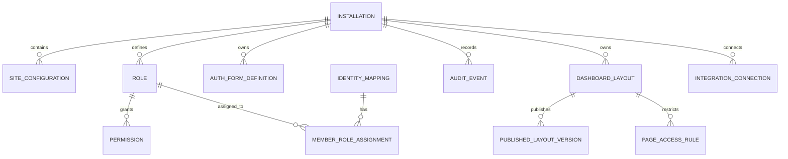

# FlexiDash Product Specification

**Document Version:** 1.0.0-phase0  
**Status:** Approved Phase 0 Baseline  
**Product:** FlexiDash  
**Scope:** Multi-Site Member Experience, Authentication, Dashboard, and Application Platform for Wix  
**Architecture Baseline:** Phase 0 Feasibility Audit (Documentation Only)

---

## 1. Product Vision & Executive Summary

FlexiDash is an installable, multi-tenant application for Wix sites that empowers site owners to design, configure, and operate a deeply customized member portal and visual application experience. Unlike standard static dashboards or fixed site templates, FlexiDash functions as a modular visual application builder tailored to the Wix ecosystem.

### Core Product Statement
> **FlexiDash is a configurable member experience and application builder for Wix: providing customizable authentication flows, member management, role-based access control (RBAC), personalized dashboards, dynamic navigation, page-level access rules, and platform integrations within a single multi-tenant app.**

### Value Proposition
- **For Site Owners:** Complete visual control over the member journey, signup/login experience, and role-specific dashboard layouts without writing custom backend code.
- **For Site Members:** A cohesive, branded portal displaying personalized navigation, profile management, and interactive widgets relevant to their assigned roles.
- **For the Platform:** Strict adherence to Wix platform boundaries, ensuring multi-site isolation, zero credential exposure, verified identity mapping, and defense-in-depth security.

---

## 2. Core Architectural Non-Negotiables

Every phase of design, prototyping, and implementation must strictly obey twelve foundational architectural principles:

1. **One App, Many Independent Wix Installations:** Every installed site operates as an isolated tenant. Configuration, member profiles, roles, layouts, and integration credentials must never bleed across site boundaries.
2. **Authentication is Not Authorization:** Authentication verifies the identity of the actor; authorization (RBAC) determines what that verified actor is permitted to see and do.
3. **CRM Contacts Are Not Wix Members:** A contact record in Wix CRM does not constitute a Wix Member. Contact IDs and Member IDs are distinct identifiers. FlexiDash must never assume a contact can log in or access member resources.
4. **Zero Plaintext Password Storage:** FlexiDash will never build, store, or manage an internal plaintext password database. All password hashing and credential validation must delegate to verified identity providers (Wix Members or compliant OIDC providers).
5. **JWT is Not a Complete Authentication System:** FlexiDash JWTs are internal API authorization tokens. They cannot establish a native Wix member session and must enforce rigorous validation (signature, issuer, audience, expiry, key rotation, and revocation).
6. **OAuth Standard Compliance:** Delegated access and third-party integrations must use standard OAuth 2.0 / OIDC specifications (PKCE, state/nonce validation, secure token exchange). Custom token endpoints or invented scopes are prohibited.
7. **Wix-Native Page Boundary vs. FlexiDash Managed Boundary:** FlexiDash cryptographically protects its own rendered components and backend APIs. It does not promise universal control or protection over native Wix pages, native navigation menus, or external Wix apps unless supported by official Wix APIs.
8. **Hiding a Menu is Not Security:** Obscuring frontend UI components or navigation items does not protect an endpoint. All data access, mutations, and actions must be strictly authorized on the backend.
9. **Conditional Third-Party Embedding:** An app cannot arbitrarily embed other Wix apps. Integration is strictly constrained to documented Wix site widgets, site plugins, official REST APIs, or authorized external iframes.
10. **Zero Cross-Site Data Access:** No query, mutation, or event handler may execute without a cryptographically verified Wix installation context (`instanceId`).
11. **Evidence-Driven Feasibility:** Every capability claim must cite official Wix developer documentation or verified proof-of-concept evidence. Speculative implementations are strictly disallowed.
12. **Mandatory Phase Gates:** Progression across roadmap phases requires full completion, automated testing, documentation, and explicit user review of the prior phase.

---

## 3. Personas and End-to-End User Journeys

```
                    ┌────────────────────────────────────────────────────────┐
                    │                      WIX ECOSYSTEM                     │
                    └────────────────────────────────────────────────────────┘
                                                 │
                        ┌────────────────────────┴────────────────────────┐
                        ▼                                                 ▼
        ┌───────────────────────────────┐                 ┌───────────────────────────────┐
        │       WIX SITE OWNER          │                 │          SITE MEMBER          │
        │   (Dashboard Administration)  │                 │    (Live Site Interaction)    │
        └───────────────────────────────┘                 └───────────────────────────────┘
                        │                                                 │
                        ▼                                                 ▼
        ┌───────────────────────────────┐                 ┌───────────────────────────────┐
        │  FlexiDash Dashboard Extension│                 │  FlexiDash Custom Element /   │
        │  • Auth Form Builder          │                 │  Site Page Extension          │
        │  • RBAC & Permission Rules    │                 │  • Custom Signup / Login UI   │
        │  • Navigation Engine          │                 │  • Profile Management         │
        │  • Dashboard Layout Builder   │                 │  • Role-Filtered Dashboard    │
        └───────────────────────────────┘                 └───────────────────────────────┘
                        │                                                 │
                        └────────────────────────┬────────────────────────┘
                                                 ▼
                                  ┌─────────────────────────────┐
                                  │   FlexiDash Backend API     │
                                  │   (Tenant-Scoped Evaluation)│
                                  └─────────────────────────────┘
```

### 3.1 Persona 1: Site Owner / App Administrator
- **Profile:** Wix business owner or agency administrator managing a membership site, online academy, or client portal.
- **Primary Goals:**
  - Install FlexiDash from the Wix App Market.
  - Configure custom registration and login screens matching site branding.
  - Establish role tiers (e.g., Tier 1, VIP, Instructor, Client) and assign permissions.
  - Assemble responsive dashboard views using reusable widgets.
  - Review member lists, role assignments, and security audit logs.
- **Critical Journey:**
  1. Accesses Wix Site Dashboard > FlexiDash.
  2. Modifies authentication form schemas (adds required custom profile fields).
  3. Configures RBAC matrix: restricts "Financial Reports" widget to `VIP` role.
  4. Publishes dashboard layout version 1.2.
  5. Reviews audit trail to verify member role promotions.

### 3.2 Persona 2: Site Member
- **Profile:** End user registered on the Wix site (student, client, premium subscriber).
- **Primary Goals:**
  - Register securely via the custom signup form.
  - Receive verification email and complete account activation.
  - Log in and automatically view the dashboard layout assigned to their role.
  - Update personal profile information synchronized with Wix CRM.
- **Critical Journey:**
  1. Navigates to `/portal/login` on the live site.
  2. Submits credentials; browser completes session handshake via Wix Members API.
  3. Frontend receives authenticated session; requests member dashboard.
  4. FlexiDash backend checks member roles (`Student`) and returns authorized widgets.
  5. Attempts direct URL access to `/portal/admin-panel` $\rightarrow$ receives HTTP 403 Forbidden with user-friendly redirect.

### 3.3 Persona 3: External Identity Provider User
- **Profile:** Enterprise member authenticating via external corporate SSO (OAuth 2.0 / OIDC provider such as Google Workspace or Okta).
- **Primary Goals:**
  - Click "Sign in with Corporate SSO" on the FlexiDash login screen.
  - Complete IdP challenge and return to the Wix site seamlessly.
  - Have their external identity mapped to an internal FlexiDash profile and linked Wix Member/Contact.
- **Critical Journey:**
  1. Initiates PKCE-protected OIDC authorization flow.
  2. External provider returns authorization code to secure FlexiDash callback.
  3. Backend verifies token, resolves subject ID (`sub`), links to Wix Member ID via `IdentityMapping`.
  4. Issues bounded session token; member accesses role-assigned portal.

### 3.4 Persona 4: Developer / Implementation Partner
- **Profile:** Technical integrator building custom extensions or deploying FlexiDash across staging and production sites.
- **Primary Goals:**
  - Deploy FlexiDash to development test sites via Wix CLI.
  - Test tenant isolation and custom API webhooks without credential leakage.
  - Validate schema definitions against strict TypeScript contracts.

---

## 4. Functional Feature Specifications

### Module A: Authentication & Identity Experience
- **A.1 Custom Form Builder:** Schema-driven visual builder for Signup, Login, Forgot Password, and Account Details forms.
  - Supports configurable text, email, password, phone, dropdown, checkbox, and terms-of-service fields.
  - Enforces client-side and server-side validation against a strict JSON schema.
  - Explicitly prohibits raw script injection (`<script>`, inline handlers, or `javascript:` URLs).
- **A.2 Authentication Flow Execution:**
  - *Mode 1 (Wix-Native Identity - PoC Required):* Authenticates credentials via Wix Members backend APIs, generating a `sessionToken` applied client-side via `@wix/site` `authentication.applySessionToken()`. *Critical Platform Boundary:* The end-to-end handshake between a Wix CLI Custom Element and Astro serverless endpoint is unverified and requires Phase 1 spike testing. Furthermore, `generateSessionToken(email)` must strictly require a prior verified authentication event, as calling it on unverified email input enables account takeover on existing accounts and creates phantom accounts with random passwords.
  - *Mode 2 (FlexiDash Managed Session):* Issues scoped JWTs for FlexiDash backend access when decoupled from native Wix member sessions.
  - *Mode 3 (Federated SSO):* Handshakes with external OIDC providers, mapping external `sub` to internal user records following verified cryptographic token validation.
- **A.3 Account Lifecycle:**
  - Configurable post-login and post-logout redirect destinations.
  - Email verification triggers and password recovery state tracking.
  - Member approval queues (Auto-approve, Manual Admin Review, or Role-conditioned).

### Module B: Role-Based Access Control (RBAC)
- **B.1 Role Architecture:**
  - *System Roles:* `Site Owner` (full management), `Site Contributor` (content editor), `Member` (default authenticated user), `Visitor` (unauthenticated).
  - *Custom Roles:* User-defined roles (e.g., `VIP`, `Student`, `Vendor`, `Staff`) unique to each site installation.
  - *Multi-Role Support:* Members can be assigned multiple roles; permissions evaluate as a union of allowed privileges with explicit deny override.
- **B.2 Policy Enforcement:**
  - Default-deny evaluation on all backend resources.
  - Prevention of self-promotion: members cannot modify their own role assignments.
  - Prevention of cross-tenant role inheritance: roles created in Site A have no validity in Site B.
- **B.3 Audit Trail:** Immutable logging of all role creation, assignment, revocation, and permission updates.

### Module C: Page & Navigation Control
- **C.1 Navigation Engine:**
  - Dynamic navigation component supporting sidebars, top headers, tab bars, and mobile drawers.
  - Menu item visibility evaluated strictly against member authentication state and active roles.
  - Separate navigation trees for logged-out visitors vs. logged-in members.
- **C.2 Direct URL & Route Guarding:**
  - Portal client routes verify backend authorization before rendering child views.
  - Direct URL access to unauthorized pages fails closed (renders 403 State or redirects to configured login route).
- **C.3 Native Wix Page Boundary:**
  - Native Wix pages (outside the FlexiDash portal) cannot be protected by FlexiDash navigation rules.
  - Site owners are provided explicit guidance to use native Wix Editor page permissions for non-FlexiDash pages.

### Module D: Visual Dashboard & Page Builder
- **D.1 Component & Layout System:**
  - Declarative JSON layout definition describing sections, grids, containers, and widgets.
  - Standard widget catalog: Metric Cards, Quick Actions, Profile Banner, Activity Feeds, Data Tables, Charts, Embed Containers, and Markdown/HTML Viewers (sanitized).
  - Responsive breakpoint settings (Mobile, Tablet, Desktop).
- **D.2 Role-Specific Views:**
  - Site owners can bind entire dashboard layouts or individual widgets to specific roles.
  - Unassigned widgets are omitted from the server-rendered component tree to prevent client-side inspection leaks.
- **D.3 Versioning & Publishing:**
  - Separate `Draft` and `Published` layout states per site.
  - Preview mode renders mock data clearly watermarked as "Preview / Demo Content".

### Module E: Member Profile & CRM Synchronization
- **E.1 Identity Separation:**
  - Enforces strict distinction between `wixMemberId`, `wixContactId`, `flexidashUserId`, and `externalSubjectId`.
- **E.2 CRM Data Exchange:**
  - Reads and updates contact records via official `@wix/crm` APIs using granted permission scopes.
  - Configurable field mapping: site owner designates which CRM fields are Member-Editable, Read-Only, or Hidden.
  - Resilient handling of unlinked contacts, deleted members, or duplicate emails.

### Module F: Integrations & Embedded Services
- **F.1 Wix Business Integrations:**
  - Optional adapters for Wix Stores (order history), Wix Bookings (upcoming appointments), and Wix Pricing Plans (active subscriptions).
  - Data fetched server-to-server using site-scoped credentials.
- **F.2 Third-Party Embedding Constraints:**
  - Support for documented iframe embedding (e.g., custom web tools, dashboards) subject to Content Security Policy (CSP).
  - Explicit recognition that arbitrary third-party Wix apps cannot be nested inside FlexiDash unless the target app exposes a supported widget or site plugin.

### Module G: Multi-Site Operations & Lifecycle
- **G.1 Installation Lifecycle:**
  - Automatic tenant provisioning upon Wix App Market installation webhook (`AppInstalled`).
  - Graceful handling of permission updates, app disablement, uninstallation (`AppRemoved`), and reinstallations.
- **G.2 Operational Security:**
  - Rate limiting on authentication and form submission endpoints.
  - PII redaction on all server logging pipelines.
  - Cryptographic tenant verification on all inbound requests.

---

## 5. Technical Scope Boundaries & Limitations

To ensure absolute architectural integrity, the functional boundary between FlexiDash and the native Wix platform is explicitly defined below:

| Functional Area | Within FlexiDash Authority | Outside FlexiDash Authority (Wix Platform Constraint) |
| :--- | :--- | :--- |
| **Portal Rendering** | Full control over FlexiDash Site Page Extensions and Custom Element Widgets. | Cannot alter arbitrary native Wix page DOM or native headers outside the portal. |
| **Authentication UI** | Full control over login/signup forms rendered within FlexiDash widgets. | Cannot intercept native Wix checkout modals, booking prompts, or password-protected native pages. |
| **Session Control** | Full authority over FlexiDash JWTs and API session lifetimes. | Native Wix session lifetime is governed by Wix Members infrastructure. |
| **Access Control** | Authoritative RBAC on all FlexiDash backend APIs and layout data. | Native Wix pages require Wix Editor Page Permissions or Velo router code. |
| **App Embedding** | Embeds public iframes or documented site widgets exposing embed interfaces. | Cannot force arbitrary third-party Wix apps into a FlexiDash container. |
| **Data Scope** | Manages dedicated FlexiDash configurations, layouts, and role bindings. | Access to Wix CRM/Members is bounded by granted Wix App Scopes. |

---

## 6. Conceptual Data Models

The following 14 data entities define the persistence domain of FlexiDash:



1. **`Installation`**: Represents a unique tenant site installation (`instanceId`, site ID, installed date, status, plan).
2. **`SiteConfiguration`**: Global app settings for the site (branding, post-login redirects, email templates).
3. **`IdentityMapping`**: Multi-identifier cross-reference linking `flexidashUserId`, `wixMemberId`, `wixContactId`, and `externalSubjectId`.
4. **`Role`**: Role definition (`roleId`, `instanceId`, name, description, priority, isSystem).
5. **`Permission`**: Atomic capability key (`permissionKey`, resource, action).
6. **`MemberRoleAssignment`**: Join entity mapping a member identity to assigned roles with assignment metadata.
7. **`AuthFormDefinition`**: JSON schema configuring layout, fields, and validation for an auth form.
8. **`AuthProviderConnection`**: Configuration and credentials for external identity providers (OIDC/OAuth).
9. **`PageAccessRule`**: Policy binding a portal route to allowed roles and redirect targets.
10. **`NavigationDefinition`**: Structured menu tree with role visibility filters.
11. **`DashboardLayout`**: Visual layout canvas containing section and widget configuration trees.
12. **`PublishedLayoutVersion`**: Immutable snapshot of a published layout version for zero-downtime serving and rollback.
13. **`IntegrationConnection`**: OAuth credentials and sync status for connected Wix or external services.
14. **`AuditEvent`**: Append-only log of security-sensitive operations (role modifications, permission changes, logins).

---

## 7. Phased Implementation Roadmap

FlexiDash adheres strictly to sequential, gated phase delivery:

- **Phase 0: Documentation-Only Feasibility Audit (Current Phase)**  
  *Deliverables:* Product Spec, Feasibility Matrix, Architecture, Decisions, Security Threats.  
  *Gate:* Complete documentation, zero code/dependency changes, explicit user approval.
- **Phase 1: Minimal App Scaffold & Integration Proof**  
  *Goal:* Prove extension rendering on Wix development site; verify CLI vs OAuth scaffolding.
- **Phase 2: Multi-Site Installation Context & Secure Backend**  
  *Goal:* Implement cryptographically verified tenant resolution and fail-closed data access.
- **Phase 3: Identity, Authentication & CRM Proof of Concept**  
  *Goal:* End-to-end custom login/signup handshake with Wix Members and CRM contact resolution.
- **Phase 4: Secure RBAC Engine**  
  *Goal:* Core policy evaluation engine, default-deny backend authorization, self-escalation prevention.
- **Phase 5: Authentication Form Builder & Auth Experience**  
  *Goal:* Schema-driven visual form builder with server-side validation and sanitized output.
- **Phase 6: Page Rules & Navigation Engine**  
  *Goal:* Role-based navigation rendering and portal client-route guarding.
- **Phase 7: Dashboard Builder MVP**  
  *Goal:* Visual dashboard layout editor, widget registry, draft/publish/rollback lifecycle.
- **Phase 8: Member Portal & Account Experience**  
  *Goal:* Complete live-site member portal shell with profile synchronization.
- **Phase 9: Wix & Third-Party Integrations**  
  *Goal:* Optional adapters for Wix business solutions and embed containers.
- **Phase 10: Security Hardening, Observability & Performance**  
  *Goal:* Pen-testing, rate limiting, audit logging, accessibility, and multi-tenant scale tests.
- **Phase 11: App Market Submission & Launch**  
  *Goal:* App Market compliance review, privacy documentation, and production distribution.

